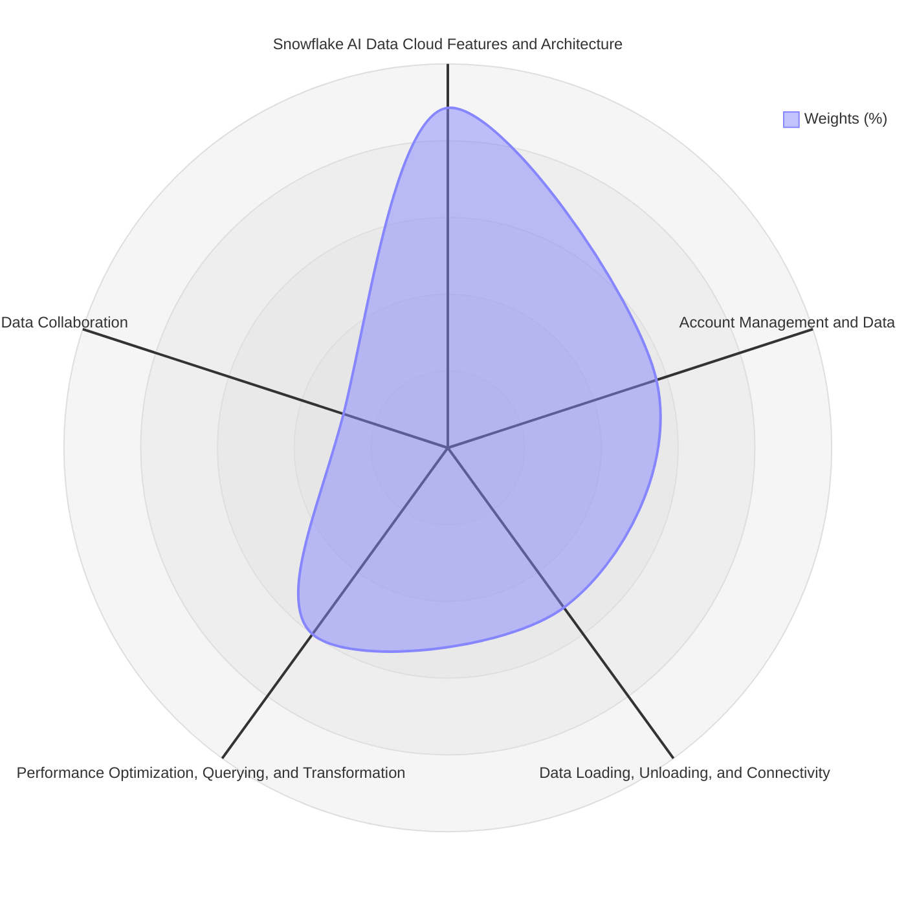

# SnowPro❄️ Core Prep

I'm a big fan of Snowflake's amazing data platfrom. My company uses it and I thought it was time to level up my skills and certify myself as a **Snow Pro**. This repository will be my notes and documents to help me prepare for Snowflake's SnowPro Core COF-03 exam. I will be using the [Essentials for Snowflake SnowPro® Core Certification](https://www.datacamp.com/tracks/essentials-for-snowflake-snowpro-core-certification) by **DataCamp** for my prep and [Snowflake's Practice Exams](https://learn.snowflake.com/en/certifications/snowpro-practice-exams/) for testing myself before the actual exam.


## 💡 ${\color{#00A1D9}\textsf{About the Exam}}$

❓ Total # of Questions: 100

📝 Question Types: Multiple Select, Multiple Choice

🕒 Time Limit: 115 minutes

💲 Registration fee: $175 USD

🏆 Passing Score: 750 + Scaled Scoring from 0 - 1000


### *Exam Domain & Weightings*
---


---


## ✨ ${\color{#00A1D9}\textsf{Using Google's Open-Knowledge Format}}$

I'll be using [Google's OKF model](https://github.com/GoogleCloudPlatform/knowledge-catalog/blob/main/okf/SPEC.md) for structuing my notes so I can use AI practice. Each course has a folder and each chapter has a markdown file associated with it, ending with a file structure that resembles this:

```text
snow-pro-core-prep/
    index.md
├── courses/
│   ├── course1/
│   │   ├── chapter1.md
│   │   └── chapter2.md
``` 


## 📚 ${\color{#00A1D9}\textsf{Courses and Chapters}}$

### Snowflake Architechture
- [ ] How Snowflake Works
- [ ] Virtual Warehouses and Loading Data
- [ ] Micro-Partitions and Data Clustering
- [ ] AI/ML, Data Protection, and Sharing

### Snowflake Management, Governance & Collaboration
- [ ] Securing Your Snowflake Account
- [ ] Data Governance
- [ ] Cost Management and Monitoring
- [ ] Data Collaboration, Sharing, and the Marketplace

### Data Pipeline Automation in Snowflake
- [ ] Data Loading, Ingestion, and Connectivity
- [ ] Pipeline Orchestration and Data Objects
- [ ] Querying and Transforming Data
- [ ] Query Performance and Optimization


## 🔗 ${\color{#00A1D9}\textsf{Useful Links}}$

|  |  |
| :--- | :--- |
| DataCamp | https://www.datacamp.com/tracks/essentials-for-snowflake-snowpro-core-certification |
| Practice Exams | https://learn.snowflake.com/en/certifications/snowpro-practice-exams/ |
| Exam | https://learn.snowflake.com/en/certifications/snowpro-core-c03/?pdf_name=SnowProCoreStudyGuideC03 |
| Google OKF | https://github.com/GoogleCloudPlatform/knowledge-catalog/blob/main/okf/README.md |
